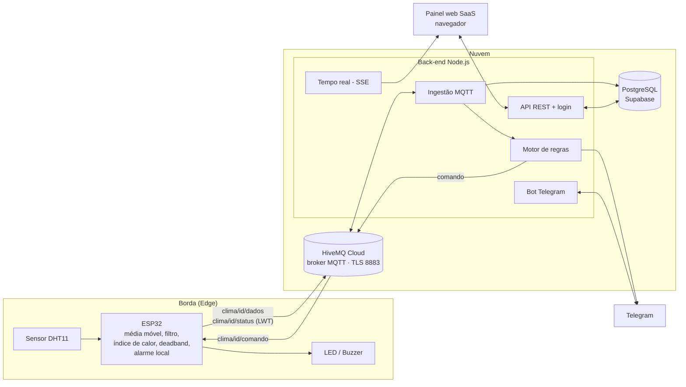
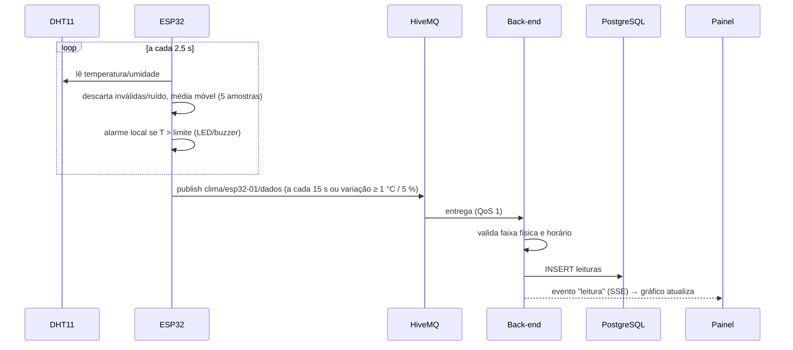
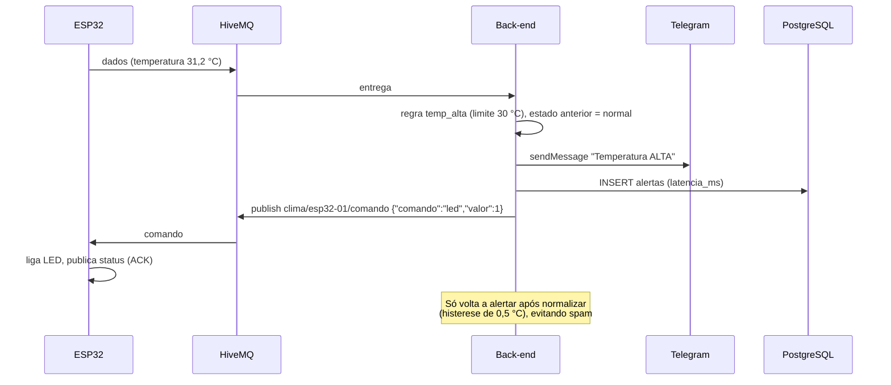
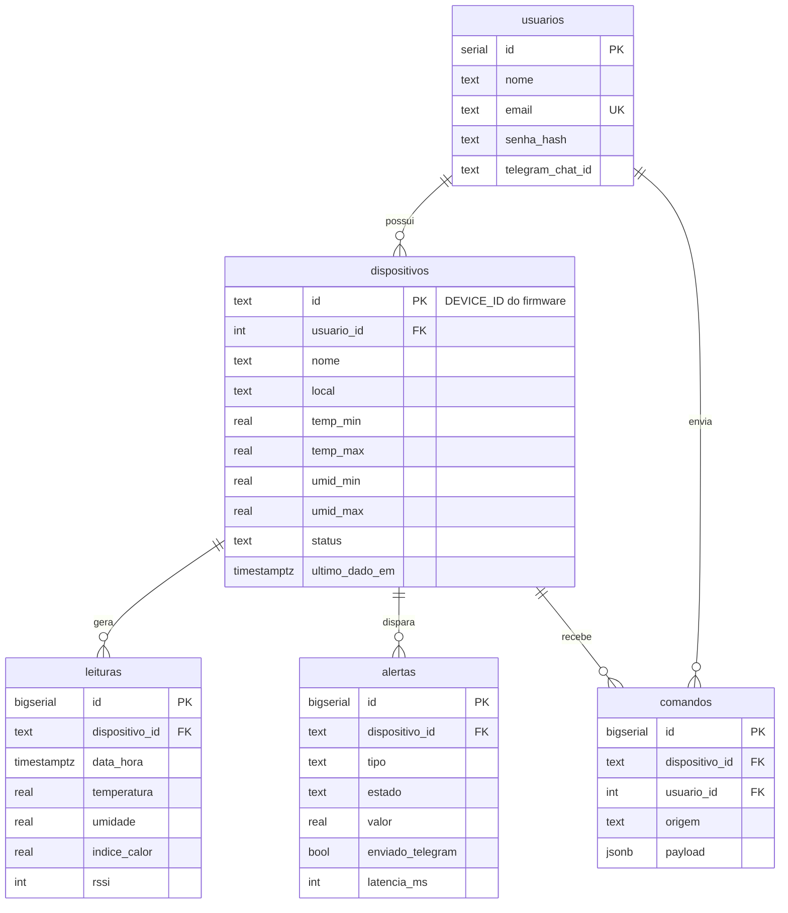

# ClimaTrack — Material para o Relatório Técnico

> Rascunho para a seção **Arquitetura do Sistema** do relatório. Os diagramas estão em Mermaid. Para colar no
> relatório, renderize-os em https://mermaid.live e exporte como PNG/SVG.

## 1. Contextualização (sugestão de texto — adaptem ao grupo)

**Problema.** Ambientes como estufas, depósitos de alimentos e medicamentos, salas de servidores e
laboratórios precisam manter temperatura e umidade dentro de faixas seguras. Hoje esse controle costuma ser
feito com termômetros e planilhas, sem histórico confiável e sem aviso imediato quando algo sai da faixa.

**Solução.** O ClimaTrack é uma plataforma SaaS de monitoramento: sensores ESP32 de baixo custo coletam e
pré-processam os dados no local, enviam por MQTT a um broker na nuvem e um back-end armazena tudo em
PostgreSQL. Cada cliente acessa um painel web com gráficos históricos, estatísticas e controles, e recebe
alertas no Telegram em segundos.

**Aplicação prática.** Exemplos: farmácia (vacinas 2–8 °C), estufa agrícola, adega, sala de TI, laboratório.

## 2. Diagrama de componentes

## 3. Fluxo de dados

### 3.1 Telemetria (borda → nuvem)

### 3.2 Alerta e acionamento (nuvem → borda e notificação)

### 3.3 Queda do dispositivo

O ESP32 conecta ao broker com **Last Will and Testament** (`clima/<id>/status = offline`, retido). Se ele perder
energia ou rede, o broker detecta pela ausência de *keep-alive* (60 s × 1,5) e publica o “testamento”. O back-end
marca o dispositivo como offline e envia alerta no Telegram. Ao reconectar, o próprio ESP32 publica `online`.

## 4. Processamento na borda (Edge Computing)

| Técnica | Por quê |
|---|---|
| Amostragem a cada 2,5 s e envio a cada 15 s | Mais dados para filtrar, menos mensagens na rede/nuvem |
| Descarte de leituras `NaN` e fora da faixa física | O DHT11 falha ocasionalmente; dados inválidos não chegam à nuvem |
| Rejeição de picos (> 10 °C da média) | Remove ruído elétrico |
| Média móvel de 5 amostras | Suaviza o sinal |
| Índice de calor (sensação térmica) | Dado derivado calculado no dispositivo |
| *Report by exception* (deadband 1 °C / 5 %) | Mudança brusca é enviada na hora, sem esperar o intervalo |
| Alarme local (LED/buzzer) | Atua mesmo sem internet — não depende da nuvem |
| Limites e intervalo ajustáveis por comando | A nuvem reconfigura a borda sem regravar o firmware |

## 5. Especificação de hardware

| Item | Especificação |
|---|---|
| Microcontrolador | ESP32 DevKit (Xtensa dual-core 240 MHz, Wi-Fi 2,4 GHz, 520 KB SRAM) |
| Sensor | DHT11: 0–50 °C (±2 °C), 20–90 % UR (±5 %), 1 leitura/s. Alternativa: DHT22 (−40–80 °C ±0,5 °C, 0–100 % ±2 %) |
| Atuadores | LED interno (GPIO 2); buzzer ativo opcional (GPIO 15) |
| Ligação | DHT DATA → GPIO 4; VCC → 3V3; GND → GND |

## 6. Modelo de dados

- **Multi-tenant**: cada usuário só enxerga os dispositivos vinculados à sua conta (`usuario_id`).
- Índice `(dispositivo_id, data_hora DESC)` acelera as consultas de séries temporais.
- Gráficos de períodos longos são **agregados no banco** com `date_bin` (média, mínimo e máximo por intervalo),
  então o navegador recebe no máximo ~180 pontos, mesmo com milhares de leituras.

## 7. Back-end e softwares utilizados

| Camada | Tecnologia | Função |
|---|---|---|
| Firmware | C++/Arduino, bibliotecas DHT, PubSubClient, ArduinoJson | Coleta, borda, MQTT |
| Broker | HiveMQ Cloud (MQTT 3.1.1/5, TLS) | Mensageria publish/subscribe |
| Back-end | Node.js 20+, Express 5, mqtt.js, pg, bcryptjs, jsonwebtoken | Ingestão, regras, API, autenticação |
| Banco | PostgreSQL (Supabase) | Persistência relacional/séries temporais |
| Front-end | HTML/CSS/JS + Chart.js | Painel SaaS, gráficos, controles |
| Notificação | Telegram Bot API | Alertas e comandos pelo celular |
| Dev local | Docker (Postgres + Mosquitto) | Ambiente de testes sem nuvem |

**Decisão de projeto:** nas aulas usamos o Node-RED como back-end low-code. Para o projeto final, o back-end foi
escrito em Node.js puro para permitir **login, várias contas (SaaS) e regras com estado** (alerta só na mudança
de estado, histerese, medição de latência), que seriam difíceis de manter em fluxos visuais.

## 8. Segurança

- MQTT sobre **TLS** (porta 8883) com **usuário/senha**; credenciais separadas para ESP32 e back-end.
- Senhas dos usuários com **bcrypt**; sessão por **JWT** em cookie `httpOnly`.
- Validação de todos os dados recebidos (faixa física, formato do `DEVICE_ID`, lista de comandos permitidos).
- Segredos fora do código, em variáveis de ambiente (`.env`, não versionado).
- Limitação conhecida (para as *Considerações finais*): o ESP32 usa `setInsecure()` (não valida o certificado do
  broker). Evolução: gravar o certificado raiz CA no firmware.

## 9. Pendente

- Análise dos modelos de nuvem (IaaS/PaaS/SaaS) e cotas dos planos gratuitos — após a aula.
- Proposta de SLA.
- Considerações finais.
