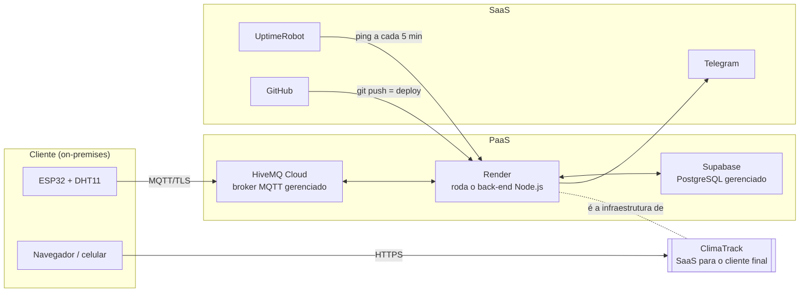

# ClimaTrack — Modelos de Nuvem e Proposta de SLA

> Material para as seções **Análise dos modelos de nuvem** e **Proposta teórica de SLA** do relatório.
> Conceitos conforme a aula de Fundamentos de Computação em Nuvem (NIST SP 800-145).
> Cotas consultadas em outubro/2026 nas páginas oficiais de cada provedor (conferir antes da entrega:
> planos gratuitos mudam com frequência).

## 1. Modelo de implantação

O ClimaTrack usa **nuvem pública**, distribuída entre vários provedores (multinuvem), mais a **borda**
(ESP32) instalada no local do cliente:

| Camada | Onde roda | Provedor / região |
|---|---|---|
| Borda (coleta, filtro, alarme local) | Local do cliente | ESP32 + DHT11 |
| Broker MQTT | Nuvem pública | HiveMQ Cloud (AWS, Europa) |
| Back-end + painel web | Nuvem pública | Render (Virginia, EUA) |
| Banco de dados | Nuvem pública | Supabase (AWS `sa-east-1`, São Paulo) |
| Notificações | Nuvem pública | Telegram |
| Monitoramento de disponibilidade | Nuvem pública | UptimeRobot |

**Quando seria híbrida:** um cliente com exigência regulatória (ex.: um hospital) poderia manter o banco de
dados num servidor próprio (nuvem privada) e continuar usando o broker e o painel na nuvem pública. Como o
back-end só precisa de uma `DATABASE_URL`, essa troca não exige mudar código.

## 2. As 5 características essenciais (NIST) na solução

| Característica | Como aparece no ClimaTrack |
|---|---|
| Autoatendimento sob demanda | Broker, banco e servidor foram criados pelos painéis web, sem falar com ninguém do provedor. O próprio cliente do ClimaTrack cria a conta e cadastra o sensor sozinho. |
| Amplo acesso à rede | O painel abre em qualquer navegador (PC ou celular); os alertas chegam no Telegram. |
| Agrupamento de recursos (multi-tenant) | Um único back-end e um único banco atendem todos os clientes; cada um vê só os próprios dispositivos (`usuario_id`). Os provedores fazem o mesmo conosco (HiveMQ *Serverless* e Supabase são compartilhados). |
| Elasticidade rápida | Trocar de plano (ex.: Render Free → Starter, HiveMQ Serverless → Starter) aumenta a capacidade sem reinstalar nada. |
| Serviço mensurado | Cada provedor mede o uso (mensagens, GB, horas). O ClimaTrack também mede o próprio serviço: latência de cada alerta, disponibilidade de cada sensor e saúde do back-end (`/api/saude`). Essas medições sustentam o SLA da seção 6. |

## 3. Mapeamento dos componentes aos modelos de serviço

| Componente | Modelo | Justificativa | O que **nós** controlamos | O que o **provedor** controla |
|---|---|---|---|---|
| **Render** (hospedagem do back-end) | **PaaS** | Implantamos nosso próprio código (Node.js); o Render fornece o *runtime*, faz o build, emite o certificado HTTPS e reinicia o serviço se ele cair. | Código, variáveis de ambiente, comando de build/start, *health check* | Servidor, sistema operacional, Node.js, rede, TLS, balanceador |
| **Supabase** (PostgreSQL) | **PaaS** (banco gerenciado, *DBaaS*) | Usamos o PostgreSQL sem instalar nem administrar o servidor. | Esquema (tabelas, índices), dados, usuários do banco, RLS | Instalação, atualizações, disco, rede, disponibilidade |
| **HiveMQ Cloud** (broker MQTT) | **PaaS** (*middleware* gerenciado) | O broker é a camada de mensageria entre a borda e a aplicação. Configuramos usuários e permissões, mas não instalamos nem mantemos o servidor. *Pode ser discutido como SaaS*, já que não implantamos código nele. | Credenciais, permissões de tópico, clientes conectados | Cluster MQTT, TLS, escalabilidade, atualizações |
| **Telegram Bot API** | **SaaS** | Usamos uma aplicação pronta pela API HTTP. | Token do bot, conteúdo das mensagens | Todo o resto |
| **UptimeRobot** | **SaaS** | Monitor externo de disponibilidade, usado como ferramenta pronta. | URL monitorada, intervalo, alertas | Todo o resto |
| **GitHub** | **SaaS** | Versionamento; cada `git push` dispara um novo deploy no Render. | Repositório | Todo o resto |
| **ClimaTrack** (nossa solução) | **SaaS** para o cliente final | O cliente só usa o navegador e o Telegram: não instala servidor, não gerencia banco nem broker, paga (no cenário real) por assinatura. É multi-tenant. | — (o cliente controla só os próprios dados, limites e o sensor) | Nós somos o provedor |
| ESP32 + DHT11 | Fora da nuvem (borda) | Hardware no local do cliente. | Tudo | — |

### 3.1 E o IaaS?

O protótipo **não usa IaaS**, por escolha. Para comparar, o mesmo sistema rodaria em uma máquina virtual
(ex.: AWS EC2, Google Compute Engine `e2-micro` ou Oracle Cloud *Always Free*) com o arquivo
`docker-compose.yml` do projeto, acrescentando o back-end:

| Item | Nossa escolha (PaaS) | Alternativa IaaS (VM + Docker) |
|---|---|---|
| Quem instala e atualiza o SO, Node, Postgres, Mosquitto | Provedores | **Nós** |
| Certificado TLS do broker e do site | Automático | Nós (ex.: Let's Encrypt) |
| Backup do banco | Do provedor (planos pagos) | Nós (`pg_dump` agendado) |
| Firewall / portas abertas | Do provedor | Nós (*security groups*) |
| Tempo até o primeiro deploy | Minutos | Horas |
| Controle e personalização | Limitado ao que o provedor permite | Total (ex.: instalar TimescaleDB, plugins do broker) |
| Custo com muitos dispositivos | Cresce por mensagem/GB/conexão | Fixo por VM, tende a ser menor em escala |
| Ponto único de falha | Cada serviço com seu SLA | Se a VM cair, cai tudo |

**Conclusão:** para um protótipo e para os primeiros clientes, o PaaS reduz o trabalho de operação e deixa a
equipe focada no produto. O IaaS passa a valer a pena em escala (custo previsível) ou quando o cliente exige
controle total da infraestrutura. O `docker-compose.yml` já usado no desenvolvimento local é, na prática, o
pacote de implantação para esse cenário.

### 3.2 Responsabilidade compartilhada

Como visto em aula, a responsabilidade sobre **dados, permissões e senhas é sempre do cliente**, em qualquer
modelo. No ClimaTrack isso significa:

- **Nós (como clientes dos provedores):** credenciais separadas por função no HiveMQ (`backend`, `esp32_dev`,
  `wokwi`), segredos fora do Git (`.env`, `secrets.h`), RLS ativado no Supabase, senhas com bcrypt e sessão
  em cookie `httpOnly` + `secure`.
- **O cliente final (do nosso SaaS):** senha da conta, rede Wi-Fi e energia no local do sensor, e cadastro do
  Telegram.

## 4. Cotas dos planos gratuitos e dimensionamento

Valores medidos no próprio projeto: cada leitura ocupa **164 bytes** no PostgreSQL (tabela + índices,
medido com 100 mil linhas) e cada mensagem MQTT tem **~220 bytes** (195 de JSON + tópico e cabeçalho).
Com o envio padrão a cada 15 s, um sensor gera **5.760 leituras por dia**.

| Serviço | Cota do plano gratuito | Consumo por sensor | Capacidade estimada |
|---|---|---|---|
| **HiveMQ Cloud Serverless** | 100 conexões simultâneas; 10 GB de tráfego/mês | ~0,08 GB/mês (entrada + saída, sem *overhead* de TLS) | ~99 sensores (o limite é o **nº de conexões**, uma é do back-end) |
| **Supabase Free** | 500 MB de banco; 5 GB de egress/mês; 2 projetos; **pausa após 1 semana sem atividade**; sem backup automático | 0,94 MB/dia → **85 MB em 90 dias** | **~5 sensores** com retenção de 90 dias; ~15 com 30 dias. **É o gargalo.** |
| **Render Free** | 750 h de instância/mês; 512 MB RAM; **dorme após 15 min sem requisições HTTP** (~1 min para acordar); pode reiniciar a qualquer momento; sem disco persistente; 1 instância | 1 serviço ligado 24 h ≈ 744 h/mês | 1 back-end (suficiente; ele atende todos os sensores) |
| **Telegram Bot API** | Gratuito; recomenda ≤ 1 mensagem/s por conversa | Só em mudança de estado (histerese) | Sem limitação prática |
| **UptimeRobot Free** | 50 monitores; verificação a cada 5 min; 3 meses de histórico; uso não comercial | 1 monitor | — |

### 4.1 Limitações dos planos gratuitos e como foram contornadas

| Limitação | Impacto | Solução no projeto |
|---|---|---|
| Render dorme após 15 min sem HTTP | O back-end deixaria de receber MQTT e de gerar alertas | O **UptimeRobot** acessa `/api/saude` a cada 5 min: mantém o serviço acordado e, ao mesmo tempo, **mede a disponibilidade** para o SLA |
| Render pode reiniciar a qualquer momento / redeploy | Mensagens perdidas e, por alguns segundos, duas instâncias ao mesmo tempo (gravação em dobro) | `MQTT_CLIENT_ID` fixo: o broker aceita só **uma** conexão com esse ID e guarda a sessão; desligamento educado no `SIGTERM`; *health check* só libera a nova versão quando banco e broker estão conectados |
| Supabase: 500 MB | Banco cheio em poucos meses | **Retenção automática**: leituras com mais de `RETENCAO_DIAS` (90) são apagadas a cada 6 h; alertas e comandos são mantidos. Agregação no banco (`date_bin`) evita tráfego (egress) desnecessário |
| Supabase pausa após 1 semana sem uso | Banco fora do ar | Não ocorre: o back-end grava leituras continuamente. A conexão tenta de novo por 30 s na partida, caso o banco esteja "acordando" |
| Supabase Free sem backup | Perda de dados em caso de falha | Aceitável no protótipo; exportação CSV pelo painel. Em produção: plano pago com backup diário |
| Sem região do Render na América do Sul | +latência entre back-end (EUA) e banco (São Paulo) | Região Virginia (a mais próxima); cada leitura é uma única consulta, então o impacto é pequeno |
| ESP32 usa `setInsecure()` (não valida o certificado) | Risco de *man-in-the-middle* | Limitação conhecida; evolução: gravar o certificado raiz no firmware |

## 5. Custo estimado em produção (hipotético)

Cenário: 50 sensores, retenção de 1 ano. O que deixa de caber no gratuito:

- **Banco:** 50 × 0,94 MB × 365 ≈ 17 GB → plano pago do Supabase (ou VM com PostgreSQL).
- **Broker:** 50 conexões e ~4 GB/mês cabem no Serverless gratuito, **mas ele não tem SLA**; para produção,
  HiveMQ Cloud Starter (SLA de 99,95% de disponibilidade).
- **Back-end:** plano pago do Render (não dorme, sem limite de horas).

> Consultar os preços atuais nas páginas oficiais na época da entrega e preencher os valores no relatório.

## 6. Proposta de SLA (cenário hipotético de produção)

**Cenário.** Uma rede de farmácias usa o ClimaTrack para monitorar as geladeiras de vacinas, que devem ficar
entre **2 e 8 °C**. Uma falha não percebida pode estragar o estoque inteiro, por isso o mais importante é que
**o alerta chegue rápido** e que **uma queda do sensor também seja avisada**.

### 6.1 Métricas (SLOs) propostas

| # | Métrica | Meta | Como é medida no protótipo | Valor observado no protótipo* |
|---|---|---|---|---|
| 1 | **Disponibilidade da plataforma** (painel + API + ingestão) | **≥ 99,5 % ao mês** (até 3 h 36 min fora do ar) | UptimeRobot consulta `/api/saude` a cada 5 min; só conta como "no ar" se banco **e** broker estiverem conectados (HTTP 200) | ver painel do UptimeRobot |
| 2 | **Latência de alerta** (leitura no ESP32 → mensagem enviada ao Telegram) | **p95 ≤ 5 s**; máximo 30 s | Coluna `alertas.latencia_ms`; o painel mostra média, p95 e máximo | ~1 s |
| 3 | **Detecção de sensor fora do ar** | Alerta em **≤ 3 min** após a queda | *Keep-alive* MQTT de 60 s (o broker detecta em até 90 s) + tolerância de 60 s contra quedas rápidas de Wi-Fi ≈ 150 s | ~150 s |
| 4 | **Disponibilidade dos dados do sensor** (completude) | **≥ 99 %** dos minutos com leitura recebida | KPI "Disponibilidade do sensor" no painel (minutos com dados ÷ minutos do período) | ver painel |
| 5 | **Latência de comando** (clique no painel → LED muda no ESP32) | p95 ≤ 2 s | Log do back-end (comando) × status de confirmação (ACK) publicado pelo ESP32 | medir na demo |
| 6 | **Atualização do painel** | ≤ 2 s após a leitura chegar | Eventos em tempo real (SSE) | < 1 s |
| 7 | **RTO** — tempo de recuperação do back-end | **≤ 5 min** | Reinício automático do Render pelo *health check*; redeploy a partir do GitHub | medir na demo (reiniciar o serviço) |
| 8 | **RTO** — reconexão do sensor após a volta da rede | ≤ 1 min | Firmware tenta reconectar Wi-Fi e MQTT a cada 5 s | ~15 s (Wokwi) |
| 9 | **RPO** — perda máxima de dados | Produção: ≤ 24 h (backup diário) | Protótipo: sem backup (Supabase Free); exportação CSV manual | — |
| 10 | **Retenção dos dados** | 90 dias de leituras; alertas indefinidamente | Rotina de retenção do back-end | — |

\* Preencher com os valores medidos durante os testes finais e a demonstração.

**Por que 99,5 % e não 99,9 %?** A disponibilidade de serviços **em série** é o produto das disponibilidades.
Supondo planos pagos com 99,95 % (HiveMQ Starter), 99,9 % (banco) e 99,9 % (hospedagem):
0,9995 × 0,999 × 0,999 ≈ **99,75 %**. Prometer mais que isso ao cliente seria prometer mais do que os
fornecedores garantem. 99,5 % deixa margem para falhas do próprio back-end.

| Disponibilidade | Indisponibilidade máxima por mês (30 dias) |
|---|---|
| 99 % | 7 h 12 min |
| **99,5 %** | **3 h 36 min** |
| 99,9 % | 43 min |
| 99,99 % | 4 min 19 s |

### 6.2 Cláusulas do acordo

- **Janela de manutenção:** domingos, das 2 h às 4 h (horário de Brasília), com aviso de 48 h. Não conta como
  indisponibilidade. Durante a manutenção **o alarme local do ESP32 continua funcionando**, porque não depende da
  nuvem.
- **Exclusões:** falta de energia ou de internet no local do cliente, sensor danificado ou desligado pelo
  cliente, indisponibilidade do Telegram (serviço de terceiro sem SLA) e casos de força maior.
- **Créditos por descumprimento** (sobre a mensalidade): disponibilidade entre 99,0 % e 99,5 % → 10 %; entre
  95 % e 99 % → 25 %; abaixo de 95 % → 50 %.
- **Suporte:**

  | Severidade | Exemplo | Primeira resposta | Solução ou contorno |
  |---|---|---|---|
  | P1 — crítica | Alertas não estão sendo enviados | 1 h, 24×7 | 4 h |
  | P2 — alta | Painel fora do ar, alertas funcionando | 4 h | 1 dia útil |
  | P3 — baixa | Dúvida, ajuste de configuração | 1 dia útil | 5 dias úteis |

- **Segurança:** todo o tráfego criptografado (TLS no MQTT, HTTPS no painel); senhas armazenadas com hash
  bcrypt; incidentes de segurança comunicados ao cliente em até 24 h.
- **Localização dos dados (soberania / LGPD):** o banco fica em São Paulo (`sa-east-1`). No protótipo o broker
  está na Europa e o back-end nos EUA, ou seja, os dados **trafegam** por fora do Brasil. Em produção, escolher
  regiões no Brasil para todos os serviços ou declarar a transferência internacional no contrato.
- **Responsabilidades do cliente:** manter Wi-Fi e energia no local do sensor, proteger a senha da conta e
  manter o Telegram cadastrado para receber alertas.
- **Relatório mensal:** disponibilidade, latência de alertas (média, p95, máximo) e disponibilidade de cada
  sensor, extraídos do UptimeRobot e do próprio painel (exportação CSV).
